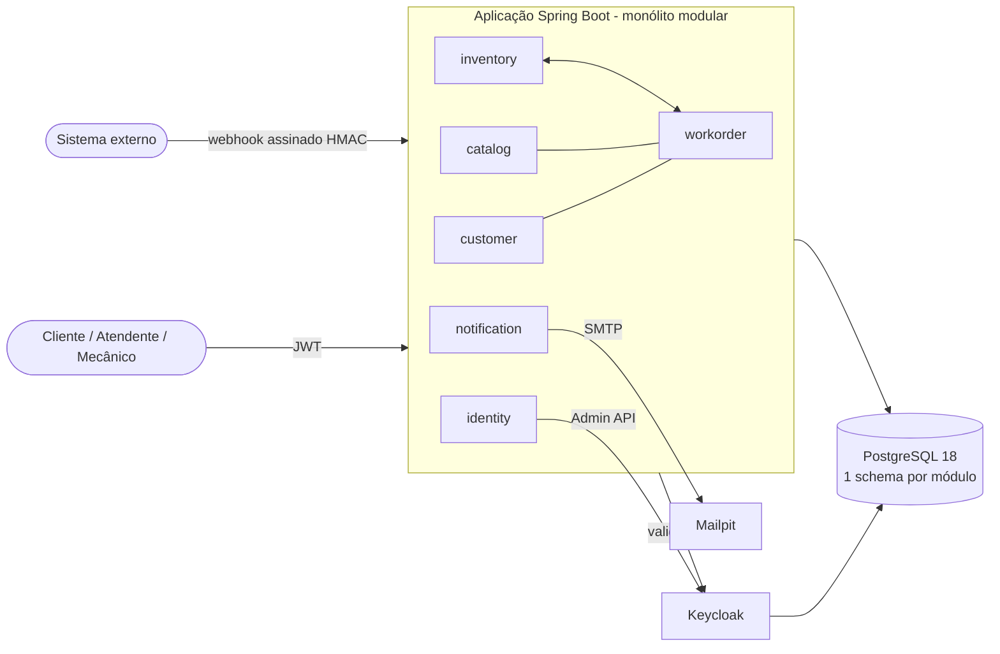
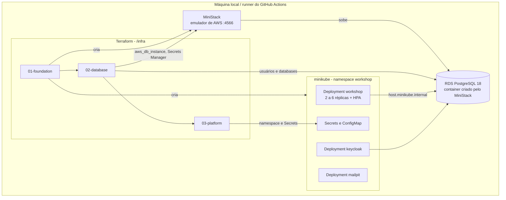
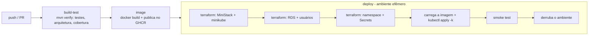

# Workshop — Sistema Integrado de Atendimento e Execução de Serviços

Back-end de uma oficina mecânica de médio porte (Tech Challenge FIAP). Gerencia clientes, veículos, catálogo de serviços,
estoque de peças e **ordens de serviço (OS)** — da abertura ao orçamento, aprovação, execução, finalização e entrega — com
acompanhamento em tempo real pelo próprio cliente.

- **Fase 1:** o MVP — monólito modular com Clean Architecture, eventos, PostgreSQL, Keycloak e testes.
- **Fase 2 (esta entrega):** evolução das APIs e infraestrutura escalável e automatizada — Kubernetes com HPA, Terraform e CI/CD.

## Objetivos da Fase 2

- Evoluir as APIs: abertura de OS com os dados do cliente e do veículo, aprovação por notificação externa, listagem priorizada e e-mail a cada mudança de status.
- Containerizar e orquestrar a aplicação em Kubernetes, com escalabilidade dinâmica (HPA) para os horários de pico.
- Provisionar o cluster e o banco de dados com Terraform (infraestrutura como código).
- Automatizar build, testes, imagem e deploy com uma pipeline de CI/CD.

## Arquitetura

### Componentes da aplicação



Detalhes dos módulos, camadas, eventos e da saga de estoque em [docs/arquitetura.md](docs/arquitetura.md).

### Infraestrutura provisionada



| Recurso | Criado por | Descrição |
|---|---|---|
| Container MiniStack (`workshop-ministack`) | `infra/01-foundation` | Emulador de AWS (RDS, Secrets Manager) na porta 4566 |
| Cluster minikube (`workshop`) | `infra/01-foundation` | Driver `docker`, com `metrics-server` para o HPA; CPUs e memória configuráveis |
| RDS PostgreSQL 18 (`workshop`) | `infra/02-database` | Instância emulada pelo MiniStack (container Postgres real) |
| Roles e databases `workshop_app`/`workshop` e `keycloak`/`keycloak` | `infra/02-database` | Criados dentro da instância; a aplicação usa um único usuário de banco |
| Secrets Manager `workshop/db/app` e `workshop/db/keycloak` | `infra/02-database` | Credenciais geradas pelo Terraform |
| Namespace `workshop` e Secrets (`workshop-db`, `keycloak-db`, `keycloak-bootstrap-admin`, `keycloak-admin-client`, `budget-webhook`, `keycloak-realm`) | `infra/03-platform` | Nenhuma senha é versionada |
| Deployments, Services, ConfigMap e HPA | `k8s/` (Kustomize) | Aplicação, Keycloak e Mailpit |

Decisões em [ADR 0014](docs/adr/0014-topologia-kubernetes-ministack-terraform.md) e [ADR 0015](docs/adr/0015-segredos-e-escala.md).

### Fluxo de deploy



## Evolução da aplicação (Fase 2)

| Requisito | Entrega |
|---|---|
| Abertura de OS | `POST /api/v1/work-orders` recebe `customer`, `vehicle`, `items` e `complaint`; devolve a OS com `id` e `number`. Cliente (por documento) e veículo (por placa) existentes são reaproveitados **sem sobrescrever**; os inexistentes são cadastrados na mesma transação ([ADR 0012](docs/adr/0012-cadastro-sincrono-na-abertura-da-os.md)). |
| Consulta de status | `GET /api/v1/work-orders?status=…` e `GET /api/v1/me/work-orders?status=…`; o detalhe da OS traz o status e o histórico. |
| Aprovação por notificação externa | `POST /api/v1/webhooks/budget-decisions`, assinado com HMAC-SHA256, com janela de tempo e idempotência ([ADR 0013](docs/adr/0013-webhook-de-decisao-com-hmac.md)). |
| Listagem de OS | Padrão: `Em execução > Aguardando peças > Aguardando aprovação > Diagnóstico > Recebida`, mais antigas primeiro, **sem** finalizadas, entregues e canceladas. `includeFinished=true` ou um `status` explícito mostram as demais. |
| Atualização de status por e-mail | O cliente recebe um e-mail a cada mudança de status (orçamento e "veículo pronto" têm e-mails próprios). |
| Clean Code e Clean Architecture | Hexagonal por módulo, verificada em todo build (ArchUnit e Spring Modulith). |
| Testes automatizados | Mais de 300 testes (unitários, de API e de integração com Testcontainers); cobertura de domínio e aplicação acima de 99%, com mínimo de 80% exigido pelo build. |

Status da OS: `RECEIVED` (Recebida) → `IN_DIAGNOSIS` (Diagnóstico) → `WAITING_APPROVAL` (Aguardando aprovação) → `IN_EXECUTION` (Execução) → `COMPLETED` (Finalizada) → `DELIVERED` (Entregue), mais `WAITING_PARTS` (Aguardando peças) e `CANCELLED` (Cancelada).

## Execução local (Docker Compose)

Pré-requisito: Docker com Compose.

```bash
cp .env.example .env        # valores de demonstração
docker compose up --build   # postgres, keycloak, mailpit e a aplicação
```

| Serviço | URL |
|---|---|
| API / Swagger UI | http://localhost:8080/swagger-ui.html |
| Keycloak (console `admin` / `admin`) | http://localhost:8081 |
| Mailpit (e-mails enviados) | http://localhost:8025 |

O perfil `demo` vem ativo e carrega clientes, veículos, serviços, peças e três OS de exemplo.

### Usuários de demonstração

A senha de cada usuário é igual ao seu nome de usuário.

| Usuário | Papel | O que pode fazer |
|---|---|---|
| `admin` | `ADMIN` | Tudo |
| `attendant` | `ATTENDANT` | Cadastros, abrir/entregar/cancelar OS, aprovar orçamento em nome do cliente |
| `mechanic` | `MECHANIC` | Itens, diagnóstico, reparo adicional, finalizar execução |
| `customer` | `CUSTOMER` | Somente a própria área (`/api/v1/me/...`) |

```bash
TOKEN=$(curl -s -d grant_type=password -d client_id=workshop-cli -d username=attendant -d password=attendant \
  http://localhost:8081/realms/workshop/protocol/openid-connect/token | jq -r .access_token)
curl -H "Authorization: Bearer $TOKEN" http://localhost:8080/api/v1/work-orders
```

## Deploy em Kubernetes (minikube)

Pré-requisitos: Docker, `minikube`, `kubectl` e `terraform`.

```bash
infra/up.sh      # cria MiniStack, cluster, banco e Secrets; constrói a imagem; aplica os manifestos
```

O script aplica as três raízes do Terraform em ordem, constrói `workshop:local`, carrega a imagem no minikube e executa
`kubectl apply -k k8s/overlays/minikube`, aguardando os rollouts. Variáveis: `CLUSTER_CPUS` (4), `CLUSTER_MEMORY` (`8192mb`),
`SKIP_BUILD=1` e `IMAGE_TAR`.

Acesso (mesmas URLs do compose, o que mantém o emissor do JWT):

```bash
kubectl -n workshop port-forward svc/workshop 8080:8080 &
kubectl -n workshop port-forward svc/keycloak 8081:8080 &
kubectl -n workshop port-forward svc/mailpit  8025:8025 &
```

Verificações:

```bash
scripts/smoke-test.sh                          # fluxo completo contra o cluster
kubectl -n workshop get pods,svc,hpa
kubectl apply -k k8s/load                      # teste de carga (k6) para ver o HPA escalar
kubectl -n workshop get hpa workshop -w
```

O **HPA** (`k8s/base/app-hpa.yaml`) escala de 2 a 6 réplicas por CPU (70%). A memória não entra: o heap da JVM não é devolvido, e a métrica mantinha as réplicas altas depois da carga. Medido no minikube com 4 CPUs, o teste de
carga levou a aplicação de 2 para 6 réplicas em cerca de 1,5 minuto (103 mil requisições, nenhuma falha, p95 de 142 ms) e ela voltou para 2 depois.

Para desfazer tudo: `infra/down.sh`.

## Provisionamento com Terraform

As raízes ficam em `/infra` e são aplicadas em ordem, porque os providers de cada uma dependem da anterior. O estado é local (`.tfstate` ignorado pelo Git).

| Raiz | Recursos |
|---|---|
| `01-foundation` | Container MiniStack e cluster minikube com `metrics-server` |
| `02-database` | RDS PostgreSQL 18, roles e databases, segredos no Secrets Manager |
| `03-platform` | Namespace `workshop` e os Secrets do Kubernetes |

```bash
terraform -chdir=infra/01-foundation init && terraform -chdir=infra/01-foundation apply
terraform -chdir=infra/02-database   init && terraform -chdir=infra/02-database   apply
terraform -chdir=infra/03-platform   init && terraform -chdir=infra/03-platform   apply
# senha do webhook, útil para assinar requisições de teste:
terraform -chdir=infra/03-platform output -raw budget_webhook_secret
```

O Terraform só usa recursos AWS por meio do MiniStack (`http://localhost:4566`); nada é criado na AWS real.

## CI/CD (GitHub Actions)

`.github/workflows/ci-cd.yml`, executado em push na `fase2`, em pull requests e manualmente:

1. **build-test** — `./mvnw verify`: compila, roda todos os testes, valida a arquitetura e exige 80% de cobertura em domínio e aplicação.
2. **image** — constrói a imagem Docker e, nos pushes, publica em `ghcr.io/lmello0/fiap-tech-challenge` (tags do commit e `fase2`).
3. **deploy** — num ambiente efêmero: instala o minikube, roda `infra/up.sh` (Terraform do cluster e do banco, imagem, manifestos), executa o
   `scripts/smoke-test.sh` e derruba tudo. Em caso de falha, coleta os logs dos pods.

## APIs

- **Swagger UI:** http://localhost:8080/swagger-ui.html (em produção, desligue com `SWAGGER_UI_ENABLED=false`)
- **OpenAPI:** [docs/api/openapi.json](docs/api/openapi.json) — um teste falha se o arquivo ficar diferente da API real
  (para regenerar: `./mvnw test -Dtest=OpenApiDocumentTest -Dopenapi.update=true`)
- **Collection Postman:** [docs/api/workshop.postman_collection.json](docs/api/workshop.postman_collection.json) — fluxo completo, com tokens e a assinatura HMAC do webhook

## Vídeo demonstrativo

_Link a ser preenchido pelo grupo._

## Testes e qualidade

```bash
./mvnw verify    # testes unitários e de integração (Testcontainers) + arquitetura + cobertura
```

Os testes de integração precisam do Docker. Análise de vulnerabilidades (Dependency-Check e Trivy): [docs/relatorio-vulnerabilidades.md](docs/relatorio-vulnerabilidades.md).

## Estrutura do repositório

```
src/main/java/com/fiap/workshop   código (módulos customer, catalog, inventory, workorder, identity, notification, shared)
config/                           realm do Keycloak e init do Postgres (usados pelo compose, pelo K8s e pelos testes)
infra/                            Terraform (01-foundation, 02-database, 03-platform) e scripts up/down
k8s/                              manifestos Kustomize (base, overlays/minikube) e teste de carga (load)
scripts/                          smoke test
docs/                             arquitetura, ADRs, linguagem ubíqua, Event Storming, APIs e relatórios
.github/workflows/                pipeline de CI/CD
```

## Documentação

- [Arquitetura](docs/arquitetura.md) · [Linguagem ubíqua](docs/linguagem-ubiqua.md) · [Event Storming](docs/event-storming.md) (resumo e [quadro no Miro](https://miro.com/app/board/uXjVH9wTsBg=/?share_link_id=625997029412))
- [Justificativa do banco de dados](docs/justificativa-banco.md) · [Decisões de arquitetura (ADRs)](docs/adr) · [Relatório de vulnerabilidades](docs/relatorio-vulnerabilidades.md)

Código, API, logs e e-mails em inglês; documentação em português.
