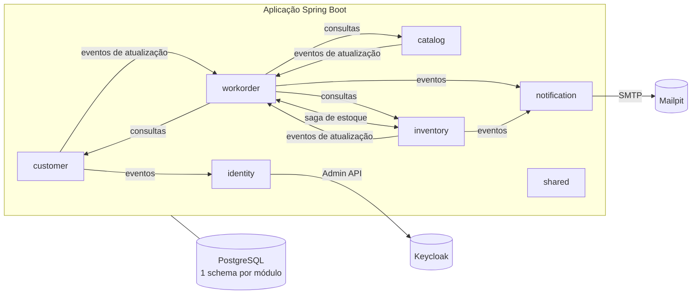
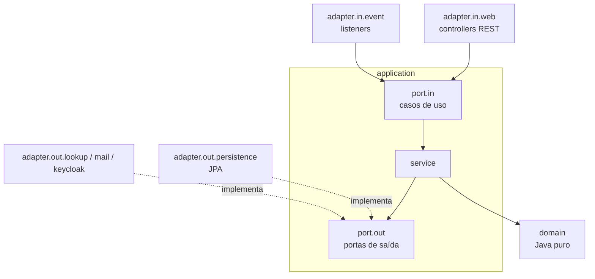
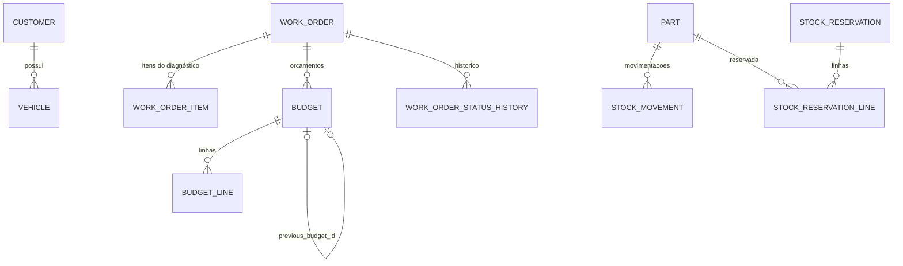
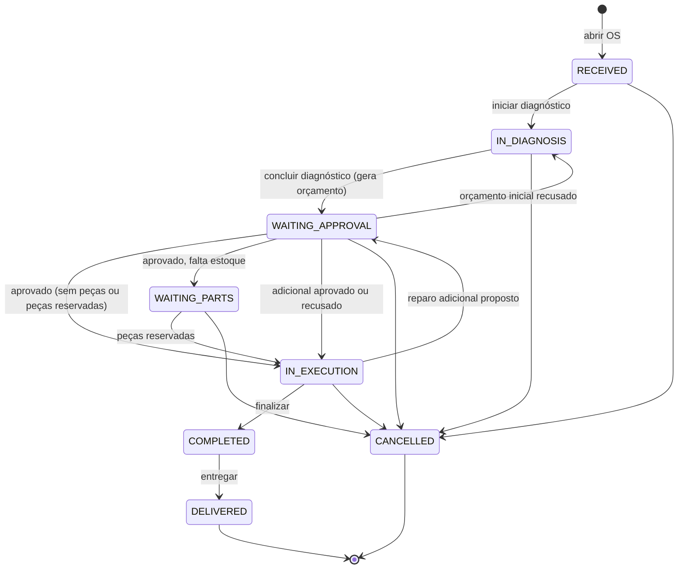
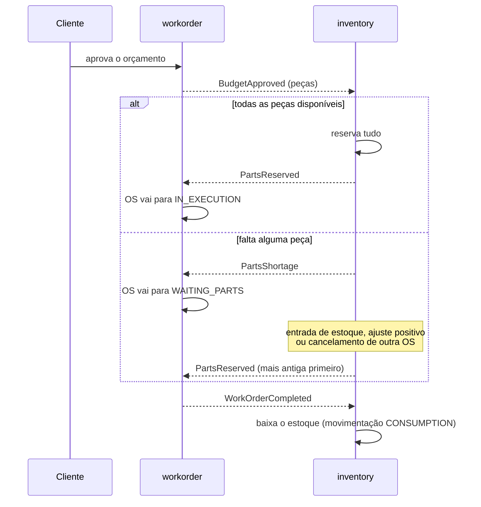

# Arquitetura

## Visão geral

A aplicação é um **monólito modular** orientado a eventos. Cada módulo é um contexto delimitado (DDD) com seu próprio
schema no PostgreSQL, e a comunicação entre módulos acontece por **eventos**, de modo que cada um possa virar um microsserviço
no futuro — a troca do barramento interno por RabbitMQ não exige mudanças nos módulos ([ADR 0004](adr/0004-eventos-com-outbox-do-modulith.md)).

## Camadas de cada módulo (Clean Architecture)

- **domain**: entidades, value objects e regras de negócio. Sem Spring, JPA ou Lombok (verificado pelo `LayeringTest`).
- **application**: casos de uso (uma operação por classe) e as portas de saída. Controla as transações e publica eventos.
- **adapter**: controllers, listeners de eventos, repositórios JPA (entidades separadas do domínio, com mapeadores), clientes de outros serviços.
- **api**: o único pacote que outros módulos podem importar — consultas síncronas somente de leitura (`CustomerQueries`, `CatalogQueries`, `InventoryQueries`) e os eventos (`api.events`).

As fronteiras são verificadas em todo build pelo Spring Modulith (`ApplicationModules.verify`). A única dependência circular
aceita é a da saga de estoque entre `workorder` e `inventory` ([ADR 0005](adr/0005-ciclo-tolerado-workorder-inventory.md)).

## Banco de dados

- Um schema por módulo: `customer`, `catalog`, `inventory`, `workorder`, `notification` e `events` (registro de publicações do Modulith).
- **Um único usuário de banco** (`workshop_app`) para toda a aplicação.
- Uma instância do Flyway por módulo, com o histórico de migrations dentro do próprio schema (`db/migration/<módulo>`).
- Nenhuma chave estrangeira, *join* ou *view* atravessa schemas: um módulo guarda *snapshots* do que precisa dos outros ([ADR 0009](adr/0009-snapshots-e-consistencia-eventual.md)).
- O perfil `demo` aplica também `db/demo/<módulo>`.

As relações entre schemas (por exemplo, `WORK_ORDER` → `CUSTOMER`) existem apenas como *snapshots* de dados, nunca como chave estrangeira.

## Ciclo de vida da OS

A máquina de estados vive no agregado `WorkOrder`; uma transição inválida lança uma exceção de domínio (HTTP 409). Cada transição grava
o autor (usuário, papel ou o próprio sistema) no histórico. Detalhes do orçamento em [ADR 0007](adr/0007-orcamento-imutavel-e-encadeado.md).

## Saga de estoque

Em caso de cancelamento, `WorkOrderCancelled` libera a reserva e já tenta atender as reservas em espera. Veja o [ADR 0008](adr/0008-estoque-reserva-tudo-ou-nada.md).

## Segurança

- A aplicação é apenas *resource server*: valida o JWT emitido pelo Keycloak. O emissor (`iss`) é validado explicitamente, porque o endereço público do Keycloak difere do interno na rede do Docker.
- Papéis: `ADMIN`, `ATTENDANT`, `MECHANIC` e `CUSTOMER`, aplicados por método (`@PreAuthorize`).
- O cliente também tem login. O claim `customer_id` do token liga a conta ao cadastro, e a posse é sempre verificada pelo token, nunca por um identificador vindo da URL. Uma OS de outro cliente responde 404.
- Erros seguem o formato RFC 9457 (`application/problem+json`).
- CPF/CNPJ (dígitos verificadores) e placa (modelo antigo e Mercosul) são validados no domínio.
