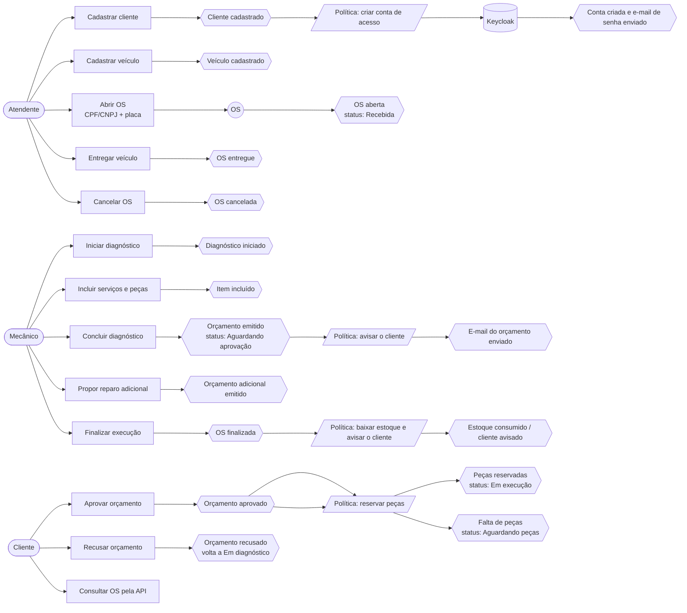
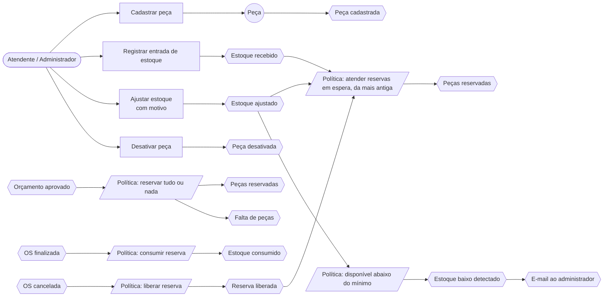

# Event Storming

Resumo textual dos dois fluxos exigidos pelo desafio, no formato usado no quadro (Miro): **eventos de domínio** (laranja), **comandos** (azul),
**atores** (amarelo), **agregados** (amarelo-claro), **políticas** (lilás) e **sistemas externos** (rosa).
O quadro completo está no Miro: [Event Storming — Workshop](https://miro.com/app/board/uXjVH9wTsBg=/?share_link_id=625997029412).

## 1. Criação e acompanhamento da OS

Pontos quentes discutidos:
- Quem decide o orçamento: o cliente pelo app, ou o atendente em nome dele (telefone/balcão), sempre registrando o canal e o autor.
- O que acontece quando o cliente recusa: a OS volta ao diagnóstico com os itens restaurados; um novo orçamento é emitido encadeado ao anterior.
- Reparo adicional: pausa a execução até a decisão, sem cancelar o que já foi aprovado.

## 2. Gestão de peças e insumos

